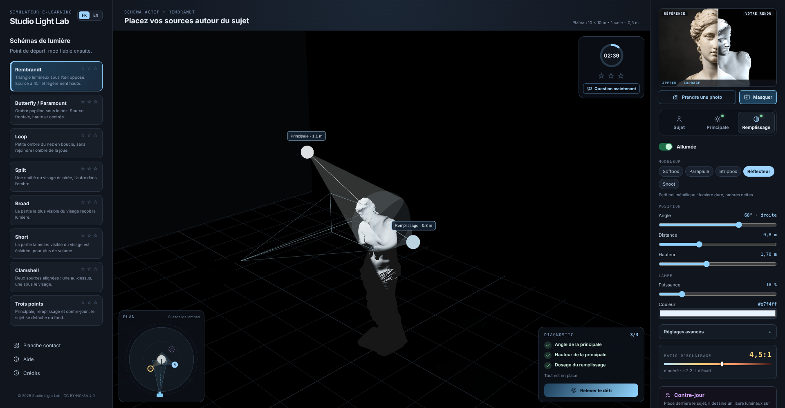

# Studio Light Lab

Apprenez les principaux schémas d'éclairage photographique en explorant un plateau virtuel en 3D : placez votre caméra, positionnez votre sujet, composez la lumière, puis observez le résultat comme si vous étiez derrière l'appareil.

Learn the key photographic lighting patterns by exploring a virtual 3D stage: place your camera, position your subject, shape the light, then see the result as if you were behind the lens.



---

## Français

### Qu'est-ce que c'est ?

Studio Light Lab est une simulation e-learning. Vous explorez les schémas de lumière classiques du portrait : **Rembrandt, Butterfly, Loop, Split, Broad, Short, Clamshell et Trois points**.

### Comment l'utiliser ?

1. **Choisissez un schéma** dans la liste : le rendu recherché s'affiche, mais le boîtier et les lampes partent déréglés (un point de départ différent à chaque essai).
2. **Onglet Sujet** : réglez le boîtier (distance, hauteur, focale), la position de la Vénus et le fond (teinte, lumière de fond).
3. **Onglets Principale et Remplissage** : modeleur, angle, distance, hauteur, puissance, couleur. Le contre-jour se règle dans l'onglet Remplissage. Vous pouvez aussi **faire glisser les lampes sur le plan** vu de dessus, en bas à gauche de la scène.
4. **Reconstruisez le rendu recherché**. Le **diagnostic** compare en direct votre scène à la référence, groupe par groupe : **cadrage** (orientation du visage, hauteur du boîtier, focale, taille du cadre), **principale** (angle, côté, hauteur), **remplissage** (dosage, côté opposé, placement) et **contre-jour**. Chaque écart est accompagné d'un conseil chiffré (« tournez le boîtier d'environ 35° vers la droite du plan », « montez la principale d'environ 30 cm »). Réussite = **1 étoile**, et la photo rejoint votre planche contact. Bloqué ? **« Voir la solution »** apparaît dans les consignes après de vrais essais (3 minutes et quelques manipulations) ou après 2 erreurs aux questions du schéma. Elle place tout comme la référence, mais annule les étoiles du schéma (défi et questions) ; on peut ensuite s'entraîner sans étoile.
5. **Questions** : toutes les 3 minutes, ou tout de suite avec « Question maintenant ». Deux bonnes réponses = **2 étoiles**.
6. **Aperçu** : comparez votre rendu au rendu recherché avec le curseur « Comparer », et prenez des photos (1920 × 1280) qui s'ajoutent à la **planche contact**, d'où vous pouvez les télécharger.

À savoir :
- Le faisceau de chaque lampe s'ajuste automatiquement pour envelopper le buste. Le **modeleur règle la douceur** : snoot et réflecteur donnent des ombres nettes, softbox et parapluie des ombres fondues.
- Le **ratio d'éclairage** (onglet Remplissage) indique le contraste entre le côté éclairé et le côté à l'ombre.
- Chaque visite repart de zéro : étoiles, questions et défis se réinitialisent quand on recharge ou quitte la page. Seule la langue choisie est retenue. Les photos sont conservées le temps de la session.
- L'interface est disponible en **français et en anglais**, et s'adapte à la tablette et au mobile.

La fenêtre de **bilan** s'ouvre automatiquement quand les 8 schémas ont leurs 3 étoiles (24/24), et reste accessible depuis « Voir mes résultats ».

### Lancer le projet

**Option A — Version en ligne ou statique**
Le workflow `.github/workflows/deploy.yml` teste, construit et publie le site sur GitHub Pages à chaque push sur `main` (Source : GitHub Actions). Vous pouvez aussi lancer `npm run build` et héberger le dossier `dist/` sur n'importe quel hébergement statique.

**Option B — Développement avec Docker**
```bash
docker compose up --build
```
Puis ouvrez http://localhost:5174.

**Option C — Développement sans Docker**
```bash
npm install
npm run dev     # http://localhost:5173
npm test        # tests (schémas, défi, traductions, contenus)
```

---

## English

### What is it?

Studio Light Lab is an e-learning simulation. You explore the classic portrait lighting patterns: **Rembrandt, Butterfly, Loop, Split, Broad, Short, Clamshell and Three-point**.

### How to use it?

1. **Pick a pattern** from the list: the target look appears, but camera and lamps start out of place (a different start each time).
2. **Subject tab**: set the camera (distance, height, focal length), Venus's position and the background (colour, background light).
3. **Key and Fill tabs**: modifier, angle, distance, height, power, colour. The rim light lives in the Fill tab. You can also **drag the lamps on the floor plan** at the bottom left of the scene.
4. **Rebuild the target look**. The live **diagnosis** compares your scene with the reference, group by group: **framing** (face orientation, camera height, focal length, frame size), **key** (angle, side, height), **fill** (amount, opposite side, placement) and **rim light**. Each gap comes with a concrete tip (“orbit the camera about 35° to the right on the plan”, “raise the key by about 30 cm”). Success = **1 star**, and the shot goes to your contact sheet. Stuck? **“Show solution”** appears in the instructions after real attempts (3 minutes and a few adjustments) or after 2 wrong answers on that pattern. It puts everything in place like the reference, but cancels that pattern's stars (challenge and questions); you can then practise without stars.
5. **Questions**: every 3 minutes, or right away with “Question now”. Two correct answers = **2 stars**.
6. **Preview**: compare your shot with the target look using the “Compare” slider, and take photos (1920 × 1280) that land on the **contact sheet**, where you can download them.

Good to know:
- Each beam automatically fits around the bust. The **modifier sets the softness**: snoot and reflector give crisp shadows, softbox and umbrella soft ones.
- The **lighting ratio** (Fill tab) shows the contrast between the lit side and the shadow side.
- Every visit starts fresh: stars, questions and challenges reset when the page is reloaded or left. Only the chosen language is remembered. Photos are kept for the session.
- The interface is available in **French and English** and adapts to tablets and phones.

The **summary** window opens automatically once all 8 patterns have 3 stars (24/24), and is always available from “See my results”.

### Running the project

**Option A — Online or static**
The `.github/workflows/deploy.yml` workflow tests, builds and publishes the site to GitHub Pages on every push to `main` (Source: GitHub Actions). You can also run `npm run build` and host the `dist/` folder on any static host.

**Option B — Development with Docker**
```bash
docker compose up --build
```
Then open http://localhost:5174.

**Option C — Development without Docker**
```bash
npm install
npm run dev     # http://localhost:5173
npm test        # tests (patterns, challenge, translations, content)
```

---

## Tech / Technique (résumé)

- **React + TypeScript + Vite** pour l'interface, **Vitest** pour les tests.
- **Three.js** (via React Three Fiber) pour la vue 3D du studio, rendue à la demande pour ménager le processeur graphique.
- Code organisé par rôle : `src/studio/model.ts` (géométrie et lumière), `content/` (schémas, questions, astuces bilingues), `challenge.ts` (diagnostic), `scene/` (3D), `ui/` (panneaux).
- Assets 3D : Vénus de Milo (CC0) et Canon EOS 60D (CC BY 4.0). Détails et crédits : `ASSETS.md`.
- Licence : voir `LICENSE`.

© 2026 Studio Light Lab · CC BY-NC-SA 4.0
